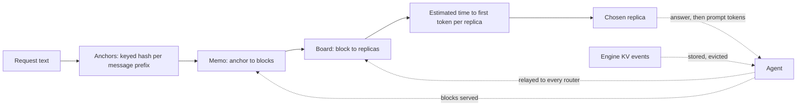

**In short:** on a mixed workload with a KV cache under pressure, switching a model's routing from `least-loaded` to `prefix-aware` cut the median time to first token of multi-turn chat by **3×** (from about 200 ms to about 63 ms), and that of requests sharing a long system prompt by about **2×**. The tail did not get worse. With no other traffic, three routers made the same choice for every prompt (64 of 64); under load, where each router also weighs the queues it sees, for 57 of 64. With tenant isolation on, no tenant's cache was reused by another. No model, GPU or client change: once the engines publish their KV-cache events to the agent (see [What to configure](#what-to-configure)), it is one line of policy.

This page explains why it works, how the algorithm was chosen, and what was measured. The workload is described in enough detail to reproduce its shape; the load generator is not published, so a re-run will not give exactly the same numbers.

<Frame caption="How many times sooner the first token arrives with prefix-aware than with least-loaded: the median, and the 99th percentile for chat (ratio of the means of 3 runs). Setup and workload below.">
  
  
</Frame>

## Why the replica matters

Before an engine writes the first token of an answer, it must read the whole prompt: the **prefill**. On a long prompt, prefill is most of the wait. Engines such as vLLM and SGLang keep the attention state of recent prompts in their **KV cache**, so a prompt that starts with tokens the engine already holds skips the prefill of that part.

That cache lives inside one replica. With four replicas, `least-loaded` sends turn 2 of a conversation to whichever replica is least busy, usually not the one that holds turn 1. The cache was there; the request went elsewhere.

Think of four librarians, each with a few books open on the desk. A reader asks to continue chapter 3. `least-loaded` sends the reader to the least busy librarian, who has to find the book and read from the start. `prefix-aware` sends the reader to the librarian who already has that book open at chapter 3, unless that one has a long queue.

The gain is largest when many requests share a long beginning: multi-turn chat (every turn repeats the conversation so far), applications with a long system prompt, RAG with the same document and different questions, and agents that fan out several requests on one context.

## What to configure

```yaml
routing_policy:
  strategy: prefix-aware
```

On the engines, publish KV-cache events to the agent's local address and report cached tokens:

```bash
vllm serve MODEL --enable-prefix-caching --enable-prompt-tokens-details \
  --kv-events-config '{"enable_kv_cache_events":true,"publisher":"zmq","endpoint":"tcp://127.0.0.1:5557","topic":"kv-events"}'

hivenet-router-agent --engine vllm --kv-events-endpoint tcp://127.0.0.1:5557 ...
```

SGLang, llama.cpp, Ollama and custom engines are supported with less precision; see [Prefix-aware routing](/routing/prefix-aware-routing#engines). Nothing else is tuned: the prefill speed and decode step of each group of replicas are learned from the engines.

## The algorithm, and why this one

A router that wants to send a request to the replica holding its prefix has to answer two questions: **what does each replica hold**, and **which of it does this request start with**. The choices below were made by measuring alternatives, not by preference.

### What each replica holds: the engines say so

The first design hashed the start of each prompt (system prompt, tools and first user message) onto a consistent-hashing ring of replicas, bounded by load. Some open-source LLM routers work this way: no state, and every router agrees. Measured on a prototype against `least-loaded`, it kept conversations together (43 of 48 conversations on one replica, against 0), but under KV pressure it was **often worse**: on 12k-token RAG documents, 24 % of prompt tokens served from cache against 37 %; on 64k-token prompts, median TTFT 12.5 s against 8.7 s. A hash of the beginning cannot see partial matches (same document, different first question), and it cannot see evictions: once a replica evicts a prefix, the ring keeps sending traffic there.

So the router follows what the caches actually hold. vLLM and SGLang publish an event for every block they store or evict. The agent next to each engine relays them to every router, re-chunked into blocks of 64 tokens. Each router keeps a **board**: block → replicas that hold it. On a prototype, **95–99.8 %** of the board's predictions were within one 16-token block of what vLLM really had in cache.

### Which blocks a request starts with: no tokenization in the router

The board speaks tokens, and a request arrives as text. Three ways to bridge the two were measured on a prototype (4 replicas, mixed workload, KV 40k tokens per replica, two seeds):

| Approach | What it costs | Result |
| --- | --- | --- |
| Ask the engine to tokenize each request before routing | An extra engine call on every request's critical path | The worst: under load the call competes with serving and timed out on up to 126 of 128 requests |
| Tokenize in the router or agent with the model's tokenizer and chat template | A Python-compatible Jinja engine kept in step with every model's template; one byte off means zero hits | Best only when the reuse is inside one message, and in some saturated runs |
| **Remember what was already served** | Nothing on the request path | **Best or equal on 4 of 5 workloads, best chat tail, zero tokenization on the critical path** |

The chosen approach rests on one observation: anything that can be in a cache has already passed through the site, so its tokens are already known. The router computes a keyed hash of each message prefix of the request (system prompt, then each message), called an **anchor**. After serving a request, the agent gets the prompt's tokens from the engine itself (vLLM returns them with the answer; the agent strips them before the answer leaves) and tells every router which blocks each anchor maps to. That is the **memo**: anchor → blocks. A new request finds its blocks through its anchors, without being tokenized. Text never seen before cannot be in any cache, so not knowing its tokens costs nothing. When the same new text arrives several times at once (fan-out), the router leaves a short **pending note** so the copies go to the same replica.



### How the replica is chosen

1. **Busy replicas are excluded**, whatever they hold: engine KV cache nearly full, a long engine queue, or many more requests in flight than the others. Holding a prefix is no use behind a queue.
2. **Each remaining candidate gets an estimated time to first token:** the prompt tokens already queued on it for prefill, plus the prompt tokens it does not hold, divided by its prefill speed, plus a term for the requests it is decoding. Cached tokens count as free. Prefill speed and decode step are learned from the engines' own counters, per model, engine and GPU.
3. **The lowest estimate wins.** Among near-ties, the candidate that holds the most of the prompt wins, then a rendezvous hash of the request's first anchor, which every router computes the same way.

This is a cost, not a rule such as "always the holder": a replica holding half the prompt behind a long queue loses to an idle one.

### Several routers, one view

Every agent reports to every router of a site: what it served, what its engine holds, and how much prefill it has queued. The routers therefore share one view without talking to each other, and break ties the same way. A conversation whose turns arrive at different routers still finds its cache. With no other traffic the routers make the same choice; under load each router also weighs the queues it sees, so they can differ (measured [below](#results)).

### Trust and privacy

- **The router never stores prompt text or tokens.** Anchors and blocks are keyed hashes. Token IDs never leave the agent, and no prompt, token or hash is logged.
- **Agents are checked.** When an answer reports how many prompt tokens the engine served from cache, the router compares it with what the board predicted. An agent whose claims do not come true loses weight in later decisions. Blocks the engine evicted after the decision are not held against it.
- **Tenants are isolated.** With [per-tenant cache isolation](/security/multi-tenant-isolation) on, the engine's cache, the anchors and the index are all scoped per tenant: one tenant's prompt never routes on, or reuses, another's.

## Measurements

### Setup

- **Hardware:** 8 × RTX 5090 32 GB in one server.
- **Engines:** 4 × vLLM 0.31.0 and 2 × SGLang 0.5.23, each serving Qwen2.5-7B-Instruct (bf16) on one GPU, prefix caching and KV events on. The KV cache is capped at 40,000 tokens per replica (vLLM `--num-gpu-blocks-override 2500`, SGLang `--max-total-tokens 40000`), the room a ~32B 4-bit model leaves on the same card. This puts the cache under pressure, the realistic case. One soak run uses the full cache instead.
- **Routers:** 3 routers; each of the 6 agents connects to all 3. Every request is sent to one of the three routers in turn (below), so a conversation moves between routers.
- **Comparison:** the same binaries, built from the prefix-aware routing pull requests (#102–#104 and #122), and the same engines, with the policy set to `least-loaded` or `prefix-aware`. Routers are restarted with an empty index for every run.

### Workload

Five workloads run at the same time in each run, closed loop, with fresh random text in every run (a seeded generator drawing words from a 50-word English vocabulary; with the Qwen2.5 tokenizer one word is one token, so ~1,900 words are ~1,900 prompt tokens). All requests are streamed chat completions with `temperature: 0` and usage reported.

| Workload | Shape | Requests per run |
| --- | --- | --- |
| Chat | 8 applications, each with its own ~1,900-word system prompt. 32 conversations, conversation *c* using application *c* mod 8, 6 turns each. Turn 1 adds a ~115-word user message; each later turn appends the previous answer and a ~57-word user message. Answers up to 48 tokens. | 192 |
| Shared prompt | 16 system prompts of ~5,700 words, 4 different ~140-word questions each, one request per question, shuffled. Answers up to 32 tokens. | 64 |
| RAG | 6 documents of ~11,400 words in the system message, 6 questions each, shuffled. | 36 |
| RAG in one message | The same shape as RAG, but the document and the question are in one user message (`document + "\n\nQuestion: " + question`). | 36 |
| Fan-out | 6 contexts of ~7,600 words in the system message; for each, 8 requests with different ~95-word user messages sent at once. | 48 |

- **Concurrency:** at most 32 (or 64) conversations, questions or fan-out groups in flight at once across all five workloads. A chat conversation holds its slot for its 6 turns.
- **Router per request:** request *k* of a workload goes to router *k* mod 3; for chat, turn *t* of conversation *c* goes to router (*c* + *t*) mod 3.
- **Metrics:** time to first token measured by the client, from sending the request to the first streamed content; cache hit is the engine's `cached_tokens` over `prompt_tokens`, summed over a workload. Three runs per configuration; tables give the range over the three.

### Results

Time to first token in ms: the median (p50), except in the *Chat p99* rows, which give the 99th percentile. Each cell is the range over three runs; cache hit in brackets.

**Concurrency 32**

| Workload | `least-loaded` | `prefix-aware` | Gain |
| --- | --- | --- | --- |
| Chat | 189–228 (63–64 %) | **61–64** (78–81 %) | **3.3×** |
| Chat p99 | 780–846 | **472–688** | 1.4× |
| Shared prompt | 844–1,224 | **448–596** | **1.9×** |
| RAG | 1,791–1,929 | **1,007–1,743** | 1.3× |
| RAG in one message | 2,341–2,471 | 1,920–2,472 | 1.1× (within run-to-run variation) |
| Fan-out | 2,814–3,103 (44–47 %) | 2,355–3,087 (62–72 %) | 1.1× |

**Concurrency 64** (the engines are saturated)

| Workload | `least-loaded` | `prefix-aware` | Gain |
| --- | --- | --- | --- |
| Chat | 695–1,144 (36–41 %) | **455–577** (48–55 %) | **1.7×** |
| Chat p99 | 4,929–6,090 | **3,772–5,096** | 1.2× |
| Shared prompt | 1,261–1,767 | **842–1,181** | 1.5× |
| RAG | 1,713–2,603 | 1,548–2,131 | 1.2× |
| RAG in one message | 2,807–3,022 | 2,808–3,298 | 0.95× (within run-to-run variation) |
| Fan-out | 3,223–4,485 | **2,856–3,877** | 1.2× |

Each gain is the ratio of the means over the three runs, of the same percentile: p50, or p99 in the *Chat p99* rows. Over all runs: 0 errors and 0 token IDs in any response.

<Frame caption="Multi-turn chat: the median drops, and the tail drops with it (mean of 3 runs).">
  
  
</Frame>

<Frame caption="Where the time goes: more of each prompt is served from the cache instead of being computed again.">
  
  
</Frame>

**The same decision on every router, when idle.** 64 prompts, each served once, then sent to each of the 3 routers in turn: all 3 chose the same replica for **64 of 64** with no other traffic, and for 57 of 64 under a concurrent load of 16. Under load each router also weighs the queues it sees, so a prompt can move to a less busy holder.

**Faults.** With the concurrency-32 workload running, one agent was stopped and restarted, one router restarted, and the caches of one vLLM and one SGLang engine reset: 0 errors in 1,128 requests, chat p50 60 ms.

**Soak.** 40 minutes at concurrency 16 with the full KV cache and the same 8 application prompts in every round, 41,360 requests: chat p50 48 ms, p99 97 ms, 92.7 % of chat prompt tokens served from cache; 0 router errors; the router's index stayed bounded and its memory flat.

**Tenant isolation.** Two tenants sent identical prompts at the same time, with per-tenant cache isolation on and then off. With it off, tenant B's first chat turns were served 86 % from cache, mostly from tenant A's prompts. With it on, 41 %: only B's own earlier conversations. No agent was penalized by the trust check in either case.

<Frame caption="With isolation on, tenant B only reuses its own earlier prompts, as much as tenant A does with its own (59 %).">
  
  
</Frame>

### Reading the results

- **The more requests share a long beginning, the larger the gain.** Multi-turn chat and shared system prompts gain most. RAG gains when the document is in its own message.
- **Reuse inside one message is not matched.** When the document and the question are in the same user message, anchors (which cover whole messages) find nothing to reuse, and the result is the same as `least-loaded`.
- **At saturation the gain shrinks but remains.** When every replica is busy, the queue weighs more than the cache in the estimate.
- **The tail does not pay for the median.** Chat p99 is lower at both concurrencies. It varies by about 1.3× between runs of the same configuration, so read it over several runs.

## When it does not help

- One replica per model: there is nothing to choose.
- Traffic without shared beginnings: every prompt is new, and the result is the same as `least-loaded`.
- Prompts much shorter than the cache block (64 tokens): little to reuse.
- Reuse inside one message, as above.

## Limits of this report

- One model size (7B) on one GPU type. Larger models prefill more slowly, so a cache hit saves more time; this was not measured here.
- A synthetic workload with uniform popularity. Real traffic, where some prompts are much more popular than others, usually reuses more.
- One server, so the network between routers and agents is local.

See [Prefix-aware routing](/routing/prefix-aware-routing) for the full guide: engines, tuning, metrics, agent trust and security.
