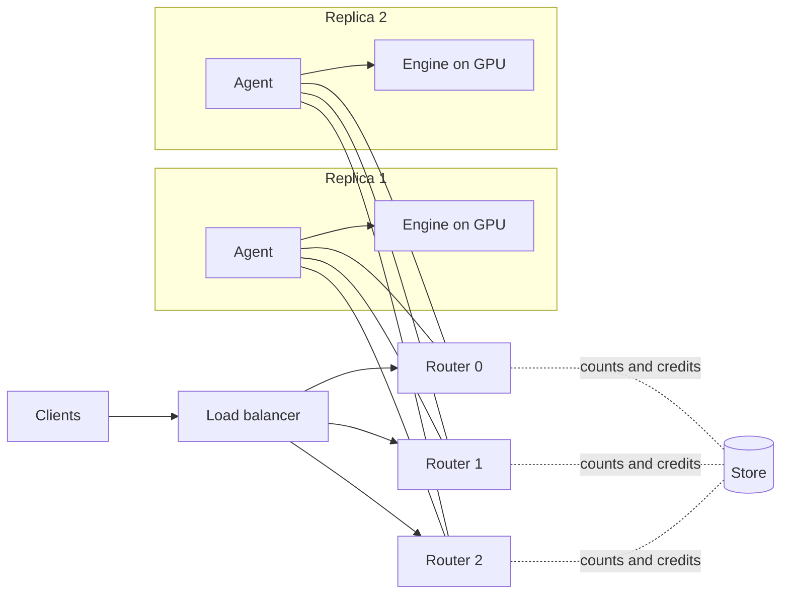

**In short:** three routers behind a plain load balancer enforce limits as if they were one router. Rate limits stay within **1.0–1.02×** of what a single router would allow, and the GPU budget was not exceeded in any test (two rare edge cases are under [Limits](#limits)). Without sharing, the three routers let **3×** through. Apart from one read per key or tenant per day, no shared-store call sits on the path of a request, so latency is unchanged (p99 202.81 ms against 202.82 ms at 1,000 requests per second). When a router is killed under load, requests through the other two all succeed. When the store's primary is killed, the routers keep serving at full throughput.

<Frame caption="Peak tokens in flight on the site with three routers and a GPU budget of 72,000 tokens. Without sharing, each router fills the whole budget; with credits, the site stays within it, and latency drops because the engine stops queueing.">
  
  
</Frame>

## The problem

One router is a single point of failure: when it stops, the site stops. The obvious fix, several routers behind a load balancer, breaks the limits. Each router counts only what it admitted itself, so with three routers:

- a key limited to 5 requests per minute gets up to 15;
- a GPU budget sized for the replicas is admitted three times over, and the engines queue and time out.

The routers must therefore share their counts. The question is how, without slowing every request down and without failing open when the shared store is unavailable.

## What to configure

Every router of the site points at the same Valkey (one primary, two replicas and three Sentinels for production), and every agent can reach every router:

```bash
hivenet-router --sync-store valkey \
  --sync-valkey-addrs sentinel-0:26379,sentinel-1:26379,sentinel-2:26379 --sync-valkey-sentinel-master hivenet \
  --sync-min-routers 3 --advertise-grpc-addr router-0.routers:50051 ...

hivenet-router-agent --routers router-0.routers:50051 ...
```

The agent needs one reachable router; it finds the others from the routers themselves. See [Run several routers](/deploy/multiple-routers) for the full setup.

## The design, and why this one

Two kinds of limits have different needs, so they are shared in two ways.

### Rate and daily limits: decided in memory, shared every second

Requests per minute, tokens per minute and tokens per day are decided by each router in memory, as with one router. Every second, each router publishes what it admitted to the store and subtracts what the others admitted. Between two rounds a router admits at most its share of what is left, so the three cannot together overshoot by more than a round's worth.

- **No store call on the request path.** Rate decisions never wait on the store, so latency is the same as with one router. The one exception is the first request of the day for a key with a daily limit, or for a tenant with a daily budget: the router reads that total once, waits at most 200 ms, and requests for the same key or tenant share the read. Keys and tenants without a daily limit never wait.
- **One second, not faster.** At 250 ms the routers admitted 0.83× of the limit (stricter than one router) for 3.5× the store calls; at 1 s, 1.0×.

### The GPU budget: credits

The GPU budget (tokens in flight on the replicas) cannot work like the rate limits. In one second each router can fill the whole budget before seeing the others: measured **3×** the budget. Asking the store on every request is exact, but a script in Valkey runs on its main thread and tops out around 74,000 calls per second. Under overload, parked requests re-checking made **543,488 calls per second**.

The router uses **credits** instead, the pattern of large-scale admission control systems such as DynamoDB's global admission control and Google's Doorman:

- the store holds the site's budget;
- each router holds a wallet of credits in memory and admits against it;
- it refills the wallet from the store when it runs low.

The store is called per refill, not per request. The budget is not exceeded, except in the two rare cases under [Limits](#limits), and it moves to the router that has the traffic.

<Frame caption="Five ways to share a GPU budget of 200 requests across three routers, under three times the load the backend can take. Only the last three stay within the budget; of those, dividing the budget by three wastes the capacity of idle routers, and one store call per request does not scale.">
  
  
</Frame>

| Way of sharing | Peak at the backend (budget 200) | Admitted per second (capacity 1,000) | Store calls per second |
| --- | --- | --- | --- |
| No sharing | 600 | 2,874 | 7 |
| Sync every second | 600 | 970 | 54 |
| Budget ÷ 3 per router | 198 | 957 | 33 |
| One store call per request | 200 | 920 | 543,488 |
| **Credits** | **200** | **967** | **1,454** |

Dividing the budget by three also stays within it, but it cannot follow the traffic. With all traffic on one router, credits admitted **964 per second (~100 %)** against 319 with a fixed split. The two store-call counts come from different conditions. The 1,454 calls per second in the table are under three times overload, where wallets keep running short and refill often. In a separate scale test without overload, from 1,000 to 10,000 requests per second, the store stayed at about **47 calls per second** with credits.

### When the store is down: degrade, never fail open

Each router keeps enforcing its share of every limit (the limit divided by the routers it last saw), so the site stays within the limits. Measured drift was **1.0–1.03×**. Two exceptions are documented:
- a request larger than a router's share still passes once per round on each router, so it is never starved;
- output tokens are charged after the response.

A router never switches to "allow all". A router that loses the store keeps the credits it holds and admits within them. The others do not take them back while that router's agents can still reach it, so the budget is never handed out twice.

### Agents connected to every router

A **replica** is one inference engine (vLLM, SGLang…) on its GPU, with an **agent** next to it. The agent is the router's only contact with the engine: it forwards requests to it and reports on it. The **routers** receive client requests and choose a replica; the **store** only holds the shared counts and credits.



- **Every agent connects to every router.** Each router therefore sees every replica, whichever router a client reached.
- **Agents report what the engine can really hold:** its current load and its KV-cache capacity. Routers admit by that, not by a request count declared on the agent.
- **When a router goes away, its agents cancel that router's requests on the engine,** so the GPU does not keep working on answers nobody will receive.

## Measurements

### Setup

- **Load and limits:** a CPU host with dedicated cores, 3 routers, Valkey 9.1 (a primary, 2 replicas and 3 Sentinels), and a stub backend that counts the requests it runs at once. The stub is the ground truth for occupancy. The load generator is open loop.
- **GPU:** a staging GPU cluster with 3 routers, Valkey 9.1 with Sentinel, and 2 replicas of a 27B model (NVFP4, tensor parallel 2) on vLLM 0.31.
- **Faults** were injected on the host:
  - `kill -9` for crashes;
  - firewall rules in the router's network namespace to cut it from the store or from its agents;
  - the cgroup freezer to freeze a router and an agent together.

### Limits across three routers

A key's limit, measured through three routers, relative to what one router admits:

<Frame caption="What one key got through three routers, relative to one router.">
  
  
</Frame>

Each setup ran the same offered load for the same time. The values are what three routers admitted divided by what one router admitted: requests for the request limit, tokens for the token limits.

| Test | 3 routers, no sharing | 3 routers, shared |
| --- | --- | --- |
| Requests per minute, 10,000 keys (limit 3/min, offered 9/min per key) | 1.8× | **1.0×, every key** |
| Tokens per minute, one key | 2.9× | **1.02×** |
| Daily budget of 200,000 tokens | — | **1.007×** |
| Daily budget of 20,000 tokens, spent in 2 s | 3.1× | **1.07–1.11×** |

**Cost of sharing:**
- one round takes about 1 ms;
- the largest message is about 10 KB at 500 requests per second per router, and it grows with the request rate, not with the number of keys;
- Valkey uses about 0.003 cores.

Latency with sharing equals latency without it: **p99 202.81 ms against 202.82 ms** at 1,000 requests per second, and 434 against 451 ms at 10,000.

### The GPU budget on real engines

3 routers and 2 replicas, with a site budget of 72,000 tokens. For 2 minutes, 8 requests per second with `max_tokens` 512 and 2 requests per second without a limit (their output grows while streaming). Occupancy summed over the three routers every 0.5 s.

| | No sharing | Credits |
| --- | --- | --- |
| Peak tokens in flight (budget 72,000) | **213,682 (3×)** | **71,963** |
| Mean tokens in flight | 112,729 | 48,084 |
| Median latency | 16.1 s | **6.4 s** |
| Timeouts | 42 | 24 |

Credits also make requests faster, because the engine no longer queues work it cannot hold. In an earlier run with a request-count budget, vLLM queued up to 53 requests without sharing (median latency 45 s, 287 timeouts) and at most 1 with credits (median 12 s, 0 timeouts), for the same number of completed requests.

With the budget taken from the engine itself (90 % of the KV cache vLLM reports), vLLM's KV cache peaked at 91.6 % with 0 preemptions.

### Faults

Under 3× overload, with a stub backend and a site budget of 9,000 tokens; then on vLLM:

| Fault | Result |
| --- | --- |
| A router killed under load | **540 of 540** requests through the other two succeeded; agents re-registered with the router when it came back |
| A router crashed during 20 s requests | its requests stopped on the engine (on vLLM within **1 s**); its credits back in about 2 s; the budget never exceeded |
| The store's primary killed | a replica promoted; routers degraded for about 4 s; **throughput unchanged** (about 990 requests per second at a budget of 1,000) |
| One router cut from the store for 60 s | the budget never exceeded; a 30-request-per-minute key admitted 62 against 69 without the cut; a daily budget of 11,000 reached 11,128 (1.01×) |
| The store restarted without its data, or flushed under load | every router detected the loss within about 2 s; the budget never exceeded |
| All of the store lost and restored | every router reconnected about 2 s after the restore |
| A request timed out by the router | the agent stopped it on the engine: 504 at 30.0 s, vLLM stopped at 30.4 s |

In every fault the peak site occupancy stayed at or below 8,032 of the 9,000 budget.

## Limits

These are the design's known edges. In every one of them the site gets less budget than it could, except the last two, which can go above by at most one router's share or while the store is down:

- A router cut from the store while its agents still reach it keeps its credits until the cut heals. The others do not reclaim them, so the budget is never handed out twice.
- A router that fails together with one of its agents (a whole machine) keeps its credits until it restarts under the same router ID.
- If the store loses its data while a router is cut off from it, and that router stays cut off past the settle window with none of its agents heard by the others, the site can go above the budget by that router's share.
- While the store is down, a request larger than a router's share is admitted alone on that router, so it is never starved. The engine may then see up to the budget once per router until the store is back; its own KV admission is the last stop.

See [Run several routers](/deploy/multiple-routers) for the full guide.
